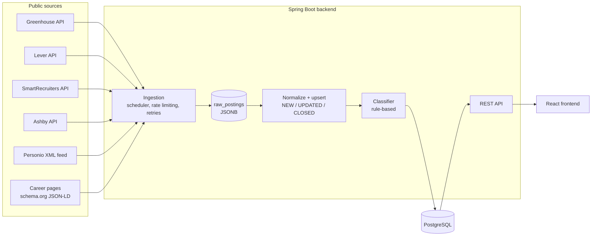
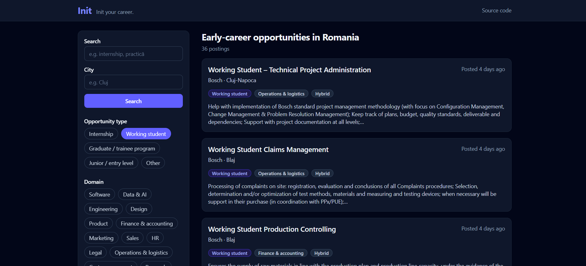
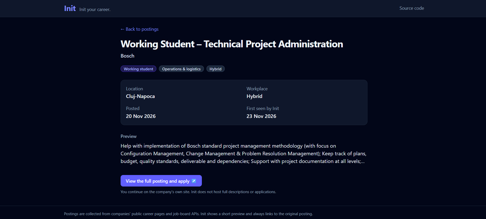

# Init

> **Init your career.** Early-career opportunities in Romania, aggregated in one place.

[](https://github.com/denis09890/init/actions/workflows/ci.yml)


Init collects internships, summer practice, working-student roles, graduate and trainee programs and
junior positions from public company sources, classifies them, and makes them searchable in a single feed.
It covers **all fields** (IT, engineering, finance, marketing, HR, legal and more) for students and
graduates with 0–2 years of experience.

---

## The problem

Early-career opportunities in Romania are scattered across dozens of company career sites, and on
general job boards they get lost among senior roles. Students often find out about an internship
after the application deadline has passed.

Init fixes this by pulling postings directly from the companies' public sources, keeping only the
early-career ones, and tracking when they open and close.

## Features

Implemented so far:

- Automated ingestion from public ATS job-board APIs (Greenhouse, Lever, SmartRecruiters, Ashby) and
  feeds (Personio), and from schema.org `JobPosting` structured data on career pages
- Detection of new, updated and closed postings, with a full history of every ingestion run
- Duplicate detection: a role a company publishes twice (or on two platforms) appears once
- Skills extraction: the technologies, tools and languages a posting asks for
- Rule-based early-career classification in English and Romanian (opportunity type, domain, location),
  measured against a hand-labelled sample of real postings: 100% precision, 95.8% recall on the
  sample ([evaluation](docs/EVALUATION.md))
- Search API with filters, pagination and full-text search
- Web UI: postings feed with filters and a detail view linking to the original posting

Planned (see the [roadmap](docs/ROADMAP.md)):

- LLM-assisted classification with a labeled evaluation set
- User profiles with an explained match score ("80% match: you have Java and SQL; missing Docker")
- Saved searches with email and Telegram alerts
- Deadline calendar, application tracker, company history pages, public market insights

## Architecture

Init is a **modular monolith**: one Spring Boot application with clearly separated feature modules
([ADR 0001](docs/adr/0001-modular-monolith.md)).



More detail in [docs/ARCHITECTURE.md](docs/ARCHITECTURE.md).

## Data sources and legal stance

Init only uses sources that are **intended to be consumed publicly**
([ADR 0002](docs/adr/0002-data-sources-and-legal-stance.md)):

1. **Public job-board APIs** of applicant tracking systems, configured per company.
2. **schema.org `JobPosting` structured data** that companies embed in their own career pages.
3. **Manual submissions**, reviewed by an admin (later milestone).

Ground rules:

- No scraping of LinkedIn, eJobs, BestJobs or any site whose terms forbid automated access.
- `robots.txt` is respected, and the crawler identifies itself with a clear User-Agent.
- Only a short snippet (max ~300 characters) and a link to the original posting are shown publicly.
  Full descriptions are never republished.
- No personal data of recruiters is stored.

## Tech stack

| Layer | Technology |
|---|---|
| Backend | Java 21, Spring Boot, Maven wrapper |
| Persistence | PostgreSQL, Flyway, Spring Data JPA |
| HTTP and concurrency | Spring `RestClient`, virtual threads |
| Parsing | jsoup (JSON-LD extraction from HTML), the JDK XML parser (Personio feeds) |
| Testing | JUnit 5, AssertJ, Mockito, Testcontainers |
| Frontend | React, TypeScript, Vite, React Router, Tailwind CSS |
| Infrastructure | Docker Compose, GitHub Actions |

## Running locally

**Prerequisites:** JDK 21 or newer, Node.js 24 (22.18 or newer also works: the frontend tests run
TypeScript directly with Node), Docker Desktop (or any Docker engine with Compose).

```powershell
# 1. Configuration
Copy-Item .env.example .env

# 2. Database
docker compose up -d

# 3. Backend (http://localhost:8080)
cd backend
.\mvnw.cmd spring-boot:run "-Dspring-boot.run.profiles=dev"

# 4. Frontend (http://localhost:5173), in a second terminal. It proxies /api to the backend.
cd frontend
npm install
npm run dev
```

Open http://localhost:5173: the postings list, with search, filters and a detail page for each posting.

On macOS or Linux use `cp` and `./mvnw` instead.

**What happens at startup:** the company catalog (`backend/src/main/resources/companies.yml`) is
synchronized into the database and, in the `dev` profile, the first ingestion starts after 10 seconds
and then repeats every 6 hours. A first run takes about 30 seconds (one request per posting for some
sources, paced politely). Then try the API:

```powershell
# Open early-career postings in Romania, newest first
Invoke-RestMethod "http://localhost:8080/api/postings?size=5" | ConvertTo-Json -Depth 5

# Full-text search (case and diacritics are ignored)
Invoke-RestMethod "http://localhost:8080/api/postings?q=student"

# Filter by city and type ("timisoara" also finds "Timișoara")
Invoke-RestMethod "http://localhost:8080/api/postings?city=timisoara&type=WORKING_STUDENT"

# Companies with their posting counts
Invoke-RestMethod "http://localhost:8080/api/companies"

# Start an ingestion by hand (dev profile only)
Invoke-RestMethod -Method Post "http://localhost:8080/api/admin/ingestion/run"
```

The results depend on what the companies publish at the moment, so the numbers change over time.
Windows PowerShell 5.1 reads the API's UTF-8 JSON as Latin-1, so accented letters (`ș`, `ț`) look
garbled in the output of `Invoke-RestMethod`; PowerShell 7 shows them correctly, and the web UI is not
affected.

The filters are listed in [docs/ARCHITECTURE.md](docs/ARCHITECTURE.md#rest-api-milestone-1).

**Troubleshooting:** `password authentication failed for user "init"` usually means a PostgreSQL
installed directly on your machine already listens on port 5432, so the backend reaches it instead of
the container. Set `DB_PORT=5433` in `.env`, then recreate the container with
`docker compose down -v` and `docker compose up -d`.

## Running tests

```powershell
# Backend: unit and integration tests (Docker must be running for Testcontainers)
cd backend
.\mvnw.cmd verify

# Frontend: lint, unit tests and production build
cd frontend
npm run lint
npm test
npm run build
```

## Development workflow

- `main` is protected: every change arrives through a pull request that must pass CI (backend build and
  tests, frontend lint, tests and build) before it can be merged.
- One branch per piece of work, named `<type>/<short-name>`; commits follow
  [Conventional Commits](https://www.conventionalcommits.org/); pull requests are squash-merged.
- Significant decisions are recorded as [architecture decision records](docs/adr/).

## Roadmap

| Milestone | Scope | Status |
|---|---|---|
| 1. Foundation | Ingestion pipeline, connectors, rule-based classifier, search API, minimal UI, CI | Complete |
| 2. Intelligence | More companies and connectors, classifier evaluation set, cross-source deduplication, skills extraction, LLM classification, public deployment | In progress |
| 3. Users | Accounts, profiles, match score, alerts, application tracker | Planned |
| 4. Growth | Telegram bot, company pages, market insights, manual submissions, more connectors | Planned |

Full breakdown in [docs/ROADMAP.md](docs/ROADMAP.md).

## Screenshots

| Postings list | Posting detail |
|---|---|
|  |  |

## Documentation

- [Architecture](docs/ARCHITECTURE.md)
- [Roadmap](docs/ROADMAP.md)
- [Classifier evaluation](docs/EVALUATION.md)
- [Architecture decision records](docs/adr/)
