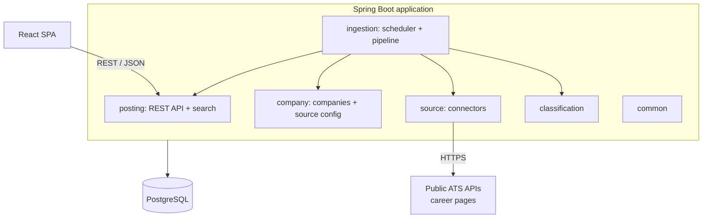
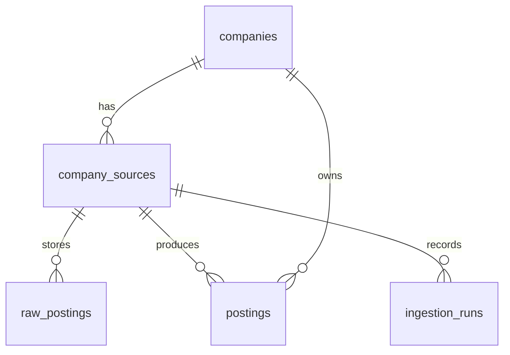

# Architecture

This document describes how Init is built and why. Decisions with long-term impact are recorded as
[ADRs](adr/). The data model below is the target for Milestone 1; it is refined as the code lands.

## Overview

Init is a **modular monolith**: a single Spring Boot application, split into feature modules with
explicit boundaries ([ADR 0001](adr/0001-modular-monolith.md)). A React single-page application
consumes its REST API. PostgreSQL is the only stateful component.



## Modules

All code lives under `dev.init`, packaged by feature.

| Module | Responsibility |
|---|---|
| `company` | Companies and their source configuration. Loads `companies.yml` and upserts it at startup. |
| `source` | One connector per source type. Fetches public data and returns raw jobs. No persistence. |
| `ingestion` | Scheduling, parallel fetching, rate limiting, retries, raw storage, normalization, upsert, change detection, run history. |
| `classification` | `PostingClassifier` interface and the rule-based implementation. Pure functions, no I/O. |
| `posting` | Posting domain model, persistence, search queries and the public REST API. |
| `common` | Cross-cutting configuration, error handling (`ProblemDetail`), utilities. |

Dependency rules:

- `source` depends only on `common`; `classification` only on `common` and the value types of
  `source` (`NormalizedJob`, `RemoteType`). Neither knows about the database.
- `ingestion` orchestrates `company`, `source`, `classification` and `posting`.
- Nothing depends on `ingestion`.
- Controllers expose records (DTOs), never JPA entities.

## Ingestion pipeline

```
Sources (ATS APIs, JSON-LD)
   │  scheduled every N hours (configurable) + manual trigger in the dev profile
   │  parallel fetch on virtual threads, per-host rate limiting, timeouts,
   │  retry with exponential backoff
   ▼
raw_postings      full payload as JSONB + payload hash (enables re-processing without re-fetching)
   ▼
normalize         source-specific payload → common NormalizedJob
   ▼
upsert            by (company_source, external_id) → NEW / UPDATED / CLOSED
   ▼
classify          early-career flag, opportunity type, domain, seniority, language
   ▼
postings          → search API → frontend
```

### Connector contract

Adding a new ATS means adding one class:

```java
public interface JobSourceConnector {
    SourceType type();
    List<RawJob> fetch(SourceTarget target);   // all published postings, raw
    NormalizedJob normalize(RawJob job);       // raw payload -> common shape
}
```

- `SourceTarget` (type, identifier, region) keeps connectors independent of JPA entities.
- `RawJob` is the external id plus the posting's JSON exactly as received; it is what
  `raw_postings` stores. Because `normalize` only needs that payload, stored postings can be
  normalized again after the normalizer improves, without fetching.
- `NormalizedJob` is the common shape: title, URL, location strings as written by the source,
  country code, workplace type, full plain-text description (used for classification and the
  snippet, never published), posting date, department, employment type and experience level.
- `SourceConnectors` looks connectors up by `SourceType`.

| Connector | Endpoint | Notes |
|---|---|---|
| Greenhouse | `boards-api.greenhouse.io/v1/boards/{token}/jobs?content=true` | One response, no paging. Description is entity-escaped HTML. Several locations in one string, separated by `;`. |
| Lever | `api.lever.co/v0/postings/{site}?mode=json` (EU: `api.eu.lever.co`) | Paged with `skip`/`limit`. `workplaceType` documented as `on-site`, returned as `onsite`; both accepted. |
| SmartRecruiters | `api.smartrecruiters.com/v1/companies/{id}/postings?country=ro` | Paged with `offset`/`limit` (max 100) until `totalFound`. The list has no description, so each posting's details are fetched and stored as the raw payload. |
| JSON-LD | the career page URL | robots.txt checked first. Reads `<script type="application/ld+json">` blocks, including `@graph`; skips broken blocks; does not follow links. |

All HTTP goes through `SourceHttpClient` (JDK `HttpClient` behind Spring `RestClient`), which sets the
`InitBot` User-Agent and timeouts (`init.http.*`) and turns failures into `SourceFetchException`
with the HTTP status and whether a retry makes sense (I/O errors, 429, 5xx). It also applies the
per-host rate limit and the retries described under *Resilience*.

Connector tests run against recorded API responses in `src/test/resources/fixtures/`, trimmed to a
few postings with descriptions replaced, so the repository never republishes job descriptions.

### Ingestion flow

For one source, `IngestionService` does the following. Fetching and normalizing happen outside any
transaction, so a slow network never holds a database connection; storing is one short transaction.

1. `IngestionRunRecorder.start` writes a `RUNNING` row to `ingestion_runs` (its own transaction).
2. The connector fetches the raw postings; each one is normalized. A posting that cannot be
   normalized, or whose id, title or URL would not fit its column, is **skipped**, not fatal.
3. `PostingSynchronizer.synchronize` stores the batch in one transaction (below).
4. The run is closed as `SUCCEEDED` with its counters, or `FAILED` with the error message. Skipped
   postings leave a note in `error_message` on a succeeded run.

`IngestionOrchestrator` runs this for every active source of every active company, in parallel on
virtual threads (at most `init.ingestion.max-parallel-sources` at once, below the connection pool
size). Only one full ingestion runs at a time; a second request gets `IngestionAlreadyRunningException`.
`IngestionScheduler` starts a run every `init.ingestion.interval` (fixed delay, so runs never
overlap) and is switched off in the `test` profile.

### Change detection

`PostingSynchronizer` compares the batch with what is stored for that source:

- **NEW**: `(company_source_id, external_id)` not seen before; the posting is classified and stored.
- **UPDATED**: the posting exists and its `content_hash` changed; it is refreshed and classified
  again. The hash covers the *normalized* fields (title, URL, locations, country, workplace type,
  description, department, employment type, experience level), not the raw payload and not the
  posting date, so volatile API timestamps do not cause false updates.
- **CLOSED**: an open posting that the source no longer publishes. This only happens after a batch
  was fetched successfully, so a failed run never closes anything. Postings that were skipped
  because they could not be normalized still count as published. Known trade-off: a source that
  successfully answers with an empty list closes all its postings.
- A closed posting that reappears is reopened (`status = OPEN`, `closed_at = null`) and counted as
  updated.
- A source that lists the same id twice is stored once (first occurrence wins).
- Every payload is kept in `raw_postings`, once per distinct content (`payload_hash`), so postings
  can be normalized and classified again later without fetching.
- The public snippet is the start of the description cut at a word boundary, at most 300
  characters (`Snippets`); the full description is never stored outside the raw payload.

### Resilience

- Each source is ingested in isolation. Whatever fails ends up on its `ingestion_runs` row and in
  the returned result; nothing is thrown at the other sources.
- `HostRateLimiter` allows `init.http.max-concurrent-requests-per-host` requests in flight per host
  (a `Semaphore`) and at least `init.http.min-request-interval` between request starts. Waiting
  threads are virtual, so waiting is cheap. Different hosts do not slow each other down.
- `RetryPolicy` retries transient failures (I/O errors, HTTP 429 and 5xx) up to
  `init.http.max-attempts` times with exponential backoff (doubling from `initial-backoff` up to
  `max-backoff`) randomized to 50–100% so parallel callers do not retry in lockstep. Other 4xx
  responses and malformed payloads fail at once. The rate limit applies to each attempt, so a request
  waiting for its retry does not hold a slot on the host.
- Implemented with the JDK and Spring only; no resilience library is needed at this scale.

### HTML sources

The JSON-LD connector checks `robots.txt` before fetching a page (RFC 9309: our own `InitBot` group,
else `*`; longest match wins; `*` and `$` supported; a missing robots.txt allows everything),
identifies itself as `InitBot/0.1 (+https://github.com/denis09890/init)`, and extracts
`<script type="application/ld+json">` blocks with jsoup, keeping objects of type `JobPosting`.
Postings without an identifier or URL get a stable id derived from their title and date.

## Classification

`PostingClassifier` takes a `NormalizedJob` and returns a `Classification`: early-career flag,
opportunity type, domain, seniority, location eligibility (Romania, or remote open to Romania/EU),
language, paid (true/false/unknown) and the list of **reasons** (which rules fired), used for
debugging now and to explain results to users later.

Milestone 1 uses keyword rules in English and Romanian with explicit exclusions
([ADR 0003](adr/0003-rule-based-classification-first.md)), implemented in `RuleBasedClassifier`
with the vocabulary in `ClassificationKeywords`:

1. **Opportunity type** from the title, then the employment-type / experience-level fields, then
   explicit phrases in the description. First match wins, in the order internship, working student,
   graduate program, junior.
2. **Exclusions** override it: senior or leadership titles, management titles unless the title itself
   says junior/trainee, and descriptions asking for 3+ years of experience. Internship,
   working-student and graduate titles are never excluded.
3. **Domain** by keyword score: title 3 points, department 2; the description only when both are silent.
4. **Location**: country `RO`, a Romanian place, or remote open to Europe; unknown locations are kept.

Matching ignores case and diacritics and compares whole words, so `practica` matches `Practică` and
`intern` does not match `internal`.

Every posting is stored; the public API returns only early-career ones by default. Milestone 2 adds
an LLM-based implementation behind the same interface, with the rules as fallback.

## Data model

Flyway owns the schema; Hibernate only validates it. Enum-like columns are `varchar` with a `CHECK`
constraint rather than PostgreSQL enum types: they map directly with `@Enumerated(STRING)` and adding a
value is a one-line migration.



**companies**: `id`, `name`, `slug` (unique), `website`, `active`, `created_at`, `updated_at`.

**company_sources**: `id`, `company_id`, `source_type` (`GREENHOUSE`, `LEVER`, `SMARTRECRUITERS`,
`JSON_LD`), `identifier` (board token, company id or page URL), `region` (`GLOBAL`, `EU`: Lever serves
EU customers from a separate API host), `active`, `created_at`. Unique on `(source_type, identifier)`.

**raw_postings**: `id`, `company_source_id`, `external_id`, `payload` (`jsonb`), `payload_hash`,
`fetched_at`. Unique on `(company_source_id, external_id, payload_hash)`, so an unchanged payload is
stored once, not on every run.

**postings**:

| Column | Notes |
|---|---|
| `id`, `company_id`, `company_source_id` | `company_id` is denormalized for filtering |
| `source_type`, `external_id` | unique on `(company_source_id, external_id)` |
| `title`, `url` | `url` points to the original posting |
| `locations` | `text[]` of normalized cities, GIN index |
| `remote_type` | `ONSITE`, `HYBRID`, `REMOTE`, `UNKNOWN` |
| `snippet` | max 300 characters |
| `posted_at`, `first_seen_at`, `last_seen_at`, `closed_at` | lifecycle timestamps |
| `status` | `OPEN`, `CLOSED` |
| `content_hash` | hash of the normalized fields, drives UPDATED detection |
| `is_early_career` | the public API filters on this by default |
| `location_eligible` | in Romania, or remote and open to Romania/EU; the public API filters on this by default. Postings outside Romania are still stored. |
| `opportunity_type` | `INTERNSHIP`, `WORKING_STUDENT`, `GRADUATE_PROGRAM`, `JUNIOR`, `OTHER` |
| `domain` | `SOFTWARE`, `DATA`, `ENGINEERING`, `DESIGN`, `PRODUCT`, `FINANCE`, `MARKETING`, `SALES`, `HR`, `LEGAL`, `OPERATIONS`, `CUSTOMER_SUPPORT`, `RESEARCH`, `OTHER` |
| `seniority` | `INTERN`, `ENTRY`, `JUNIOR`, `MID`, `SENIOR`, `LEAD`, `UNKNOWN` |
| `language` | ISO 639-1 code of the posting text (`en`, `ro`), nullable |
| `paid` | nullable: unknown is different from unpaid |
| `search_vector` | generated `tsvector` over title and snippet, GIN index |

Full-text search uses the `simple` text-search configuration, because postings are a mix of English and
Romanian and a language-specific stemmer would mangle the other language. Known limitation: `simple`
neither stems nor removes diacritics, so `practica` does not match `practică`. The search API will
normalize queries; a diacritic-insensitive index (`unaccent`) is a Milestone 2 candidate.

Hashes (`payload_hash`, `content_hash`) are hex-encoded SHA-256 stored as `varchar(64)`. Timestamps
are `timestamptz`, mapped to `java.time.Instant`. Classification enums are owned by the
`classification` module, `SourceType` and `SourceRegion` by the `source` module.

**ingestion_runs**: `id`, `company_source_id`, `source_type`, `started_at`, `finished_at`, `status`
(`RUNNING`, `SUCCEEDED`, `FAILED`), `fetched_count`, `new_count`, `updated_count`, `closed_count`,
`error_message` (the failure on a failed run, or a note about skipped postings on a succeeded one).

Indexes support the feed filters: `(is_early_career, location_eligible, status, posted_at desc)`,
`opportunity_type`, `domain`, `company_id`, plus the GIN indexes above.

## REST API (Milestone 1)

| Method and path | Purpose |
|---|---|
| `GET /api/postings` | Filters, pagination, full-text `q`. Early-career only by default. |
| `GET /api/postings/{id}` | Posting detail with a link to the original. |
| `GET /api/companies` | Companies with active sources. |
| `POST /api/admin/ingestion/run` | Manual ingestion trigger, `dev` profile only. |
| `GET /actuator/health` | Health check. |

Errors use RFC 9457 `ProblemDetail` responses.

## Configuration and profiles

- All environment-specific values come from environment variables. `.env.example` documents them;
  `.env` is git-ignored.
- `dev`: local PostgreSQL from Docker Compose, manual ingestion endpoint enabled, first scheduled
  ingestion 10 seconds after startup.
- `test`: PostgreSQL from Testcontainers, scheduler disabled.
- Ingestion and HTTP behaviour is tuned with `init.ingestion.*` (scheduler on/off, interval, initial
  delay, parallel sources) and `init.http.*` (timeouts, per-host concurrency and spacing, retries);
  the defaults are listed in `application.yaml`.
- Companies and their sources are configured in `backend/src/main/resources/companies.yml`
  (see below). The `test` profile disables the startup sync; tests synchronize what they need.

## Company catalog

`companies.yml` is bound to `CompanyCatalogProperties` (records, Bean Validation: slug format,
https website, at least one source, source type and identifier required). Invalid entries stop the
application at startup.

`CompanyCatalogSynchronizer` runs once at startup and makes the database match the file:

- companies are matched by `slug`, sources by `(source_type, identifier)`;
- new entries are created, changed names, websites and regions are updated;
- entries missing from the file are **deactivated, never deleted**, so their postings and ingestion
  history remain; they are reactivated if they come back;
- duplicate slugs or sources in the file, and moving a source to another company, are rejected.

The sync is idempotent and logs what it changed. Every identifier in the file is verified against
the live public API, and entries added before the curated list exists are marked `example: true`.
